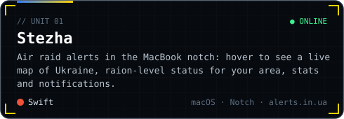
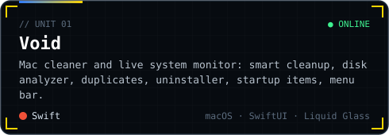
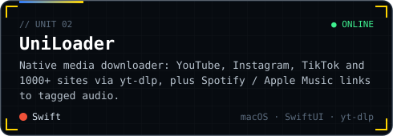
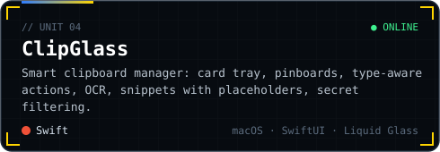
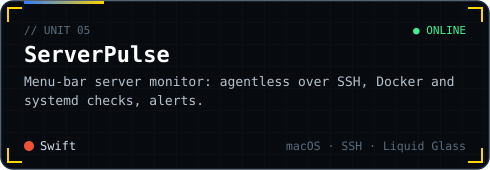
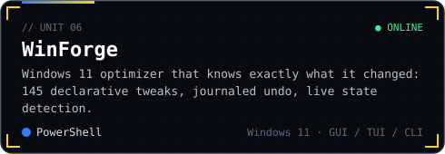

<div align="center">



</div>

<br>

```text
┌──────────────────────────────────────────────────────────────────────────────┐
│  > ACCESS GRANTED · OPERATOR PROFILE LOADED                                  │
└──────────────────────────────────────────────────────────────────────────────┘
```

### `// 01` &nbsp;BRIEFING

I build **mission-critical, high-performance interfaces** for military and tactical projects.
In my line of work, software has to be fast, resilient and intuitive under pressure, because there's no second chance.

```ts
const operator: Engineer = {
  callsign:  "v1rus91",
  name:      "Andrii Kaznachei",
  base:      "Cherkasy, Ukraine 🇺🇦",
  role:      "Defense-Tech Front-End Developer",
  core:      ["Next.js", "TypeScript", "React"],
  support:   ["Python", "Swift / SwiftUI", "PowerShell"],
  doctrine:  "scalable · secure · responsive under load",
  mission:   "Building the digital infrastructure for modern defense.",
};
```

### `// 02` &nbsp;ARSENAL

<p>
  
</p>

```text
 FRONT-END   ██████████████████████  Next.js · React · TypeScript
 NATIVE      ███████████████░░░░░░░  Swift · SwiftUI · Liquid Glass
 SCRIPTING   ██████████████░░░░░░░░  Python · PowerShell
 OPS         ██████████░░░░░░░░░░░░  Docker · Linux · SSH
```

### `// 03` &nbsp;FIELD EQUIPMENT

<p align="center">
  <a href="https://github.com/v1rus91/Stezha"></a>
  <a href="https://github.com/v1rus91/Void"></a>
  <a href="https://github.com/v1rus91/UniLoader"></a>
  <a href="https://github.com/v1rus91/ClipGlass"></a>
  <a href="https://github.com/v1rus91/ServerPulse"></a>
  <a href="https://github.com/v1rus91/WinForge"></a>
</p>

### `// 04` &nbsp;OPERATING PRINCIPLES

```text
 [✓] Speed is a feature: every millisecond counts in the field
 [✓] Fail safe: undo, journals and confirmations before anything destructive
 [✓] Clarity under stress: dense information, zero noise
 [✓] Native when it matters: real apps, not wrappers
```

<br>

<div align="center">


<sub><code>EOF · transmission complete · stay safe</code></sub>

</div>
